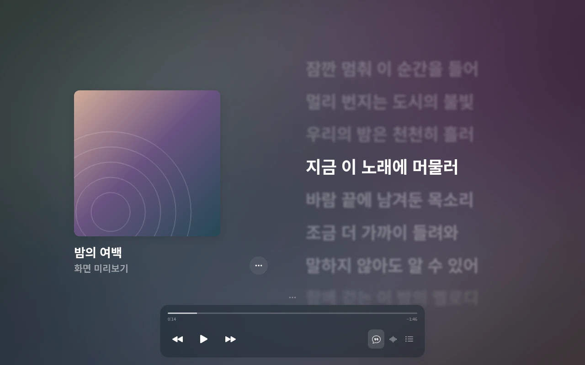
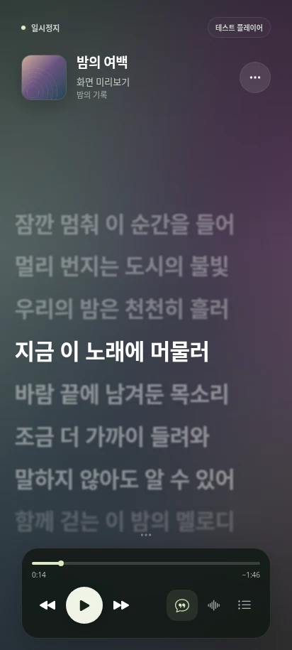

<div align="center">

# BetterLyrics Mobile

### Your music. Your lyrics. Your screen.

An Android lyric companion that follows playback in your music app.<br>
Large lyrics, album-color gradients and a layout you can make your own.

[](https://github.com/Duioolllll/BetterlycisFor-mobile/releases/tag/v0.6.0)
[](docs/INSTALL_EN.md)
[](LICENSE)

### [↓ Download Android APK · v0.6.0](https://github.com/Duioolllll/BetterlycisFor-mobile/releases/download/v0.6.0/BetterLyrics-Mobile-0.6.0.apk)

**Released October 27, 2026** · Android 8.0+ · 2.3 MiB · versionCode 14

[Release / Assets](https://github.com/Duioolllll/BetterlycisFor-mobile/releases/latest) · [Installation](docs/INSTALL_EN.md) · [Changelog](changelog/README.md) · [한국어](README.md) · [简体中文安装](docs/INSTALL_ZH.md)



</div>

> **Installing for the first time?** Choose **Download Android APK** above. The source ZIP is not an Android installer. If the download is unavailable, use the [repository fallback](https://github.com/Duioolllll/BetterlycisFor-mobile/raw/refs/heads/main/downloads/BetterLyrics-Mobile-0.6.0.apk).

## Lyrics that follow your music

| Focus on the words | Connected to playback | Make it yours |
| --- | --- | --- |
| Progress-based scrolling, active-line emphasis, supplied word timing and per-song offsets | Android MediaSession detection, album art, playback, seeking and volume | Layout presets, typography, alignment, spacing, album-color gradients and optional sound-reactive backgrounds |

LRCLIB / NetEase search, manual candidate selection, local lyric import/cache and floating lyrics are supported. Matching compares Korean title aliases, recording versions and duration. Lyrics without word timing use line timing. **The app interface is currently Korean.**

<details>
<summary><strong>Portrait screen and more features</strong></summary>

<p align="center">
  
</p>

- **Lyrics:** LRC / Enhanced LRC / ESLRC / TTML, decoded QRC·KRC·YRC and binary KRC import; scrub preview, return to current lyrics and per-song timing offsets.
- **Appearance:** default / focus / album presets; saved type weight, blur, brightness, cover, colors and auto-hiding playback controls.
- **Widget:** home-screen lyrics and playback controls with appearance settings.
- **Background:** default album-color gradient; optional actual-audio response, intensity controls, reduced motion and a fallback when WebGL is unavailable.
- **Music apps:** a compatible MediaSession is required. Artwork, lyrics, seeking and audio sharing depend on the source app and provider.

</details>

Screenshots show the actual bundled web UI with synthetic track metadata and original sample lyrics. They are browser captures, not Android hardware captures. Runtime album art comes from your music app.

## Get started in three steps

1. **[Download v0.6.0 APK](https://github.com/Duioolllll/BetterlycisFor-mobile/releases/download/v0.6.0/BetterLyrics-Mobile-0.6.0.apk)** and open it. If prompted, allow installation only for the browser or file app opening this file.
2. Launch → **··· → 음악 감지** (music detection) → allow notification access. Play a song in your music app and return.
3. Open **··· → 화면 꾸미기** (appearance) to choose lyrics, background and layout. Audio response and floating lyrics are optional.

**Installation:** [한국어](docs/INSTALL_KO.md) · [English](docs/INSTALL_EN.md) · [简体中文](docs/INSTALL_ZH.md)

Read Play Protect warnings and stop if the app is identified as harmful. You can revoke the install-source permission afterward. Updates require the same package and signature; uninstalling may remove settings and lyric caches. The installation guides explain permissions and common failures.

## In this release · 0.6.0

- **Home-screen widget:** current song and lyrics, available playback controls and tap to open the app.
- **Widget appearance:** dark, light or translucent background, three text sizes, optional album art and resizing.
- **Fonts:** preview and choose four bundled Korean fonts offline, alongside system fonts.
- **Concise settings:** function names and relevant status replace repetitive descriptions.

[0.6.0 release notes](changelog/0.6.0.md) · [Widget and font guide](docs/HOME_WIDGET.md) · [All versions](changelog/README.md)

0.4.0 has a confirmed installation defect. **Use the current 0.6.0 download.** 0.4.2 was committed as source only and has no separate public APK release.

<details>
<summary><strong>Download details · SHA-256 · actual verification</strong></summary>

| Item | Value / result |
| --- | --- |
| File | `BetterLyrics-Mobile-0.6.0.apk` · 2,386,889 bytes |
| Package / version | `io.betterlyrics.mobile` · 0.6.0 (14) |
| Android | Minimum 8.0 (API 26) · compile / target 16 (API 36) |
| APK | Universal · no native `.so` |
| Offline checks | 233 passed · 2,073 bit-identical baseline audio frames · 5 packaging cases passed |
| Signing / builds | v2/v3 · previous certificate match · ZIP alignment · two byte-identical same-environment builds |
| Browser UI | Six suites · 61 check groups passed |
| Android 16 AVD | Widget, fonts, install and update gates; see attached reports |
| Public file | Post-publication APK download and SHA-256 verification step |

```text
51b02a69474bee9b4e9c2cbe465598e89086267b7dfc4b9d1757a302ba6abfd4
```

[SHA256SUMS](https://github.com/Duioolllll/BetterlycisFor-mobile/releases/download/v0.6.0/SHA256SUMS) · [RELEASE_VALIDATION.json](https://github.com/Duioolllll/BetterlycisFor-mobile/releases/download/v0.6.0/RELEASE_VALIDATION.json) · [UI_VALIDATION.json](https://github.com/Duioolllll/BetterlycisFor-mobile/releases/download/v0.6.0/UI_VALIDATION.json) · [WIDGET_VALIDATION.json](https://github.com/Duioolllll/BetterlycisFor-mobile/releases/download/v0.6.0/WIDGET_VALIDATION.json) · [INSTALL_VALIDATION.json](https://github.com/Duioolllll/BetterlycisFor-mobile/releases/download/v0.6.0/INSTALL_VALIDATION.json) · [Workflow run](https://github.com/Duioolllll/BetterlycisFor-mobile/actions/workflows/release.yml) · [Validation scope](docs/VALIDATION.md)

</details>

## Documentation and development

| User guides | Developer references |
| --- | --- |
| [한국어 설치·업데이트·문제 해결](docs/INSTALL_KO.md) | [Environment, modules and OS setup](docs/DEVELOPMENT.md) |
| [English installation](docs/INSTALL_EN.md) | [Debug / Release builds, signing and ADB](docs/BUILD.md) |
| [简体中文安装指南](docs/INSTALL_ZH.md) | [Official and unofficial APIs](docs/API_REFERENCE.md) |
| [Release and change history](changelog/README.md) | [REA analysis and Android reconstruction](docs/REVERSE_ENGINEERING.md) |
| [Validation and unverified behavior](docs/VALIDATION.md) | [Security and license review](docs/SECURITY_AND_LICENSES.md) |

**Stack:** Java 8 source/target · JDK 17 · Android SDK 36 / Build Tools 36.0.0 · WebView HTML/CSS/JavaScript + WebGL · Python 3 builder. No external Android runtime framework. AGP 8.10.1 configuration exists; Gradle execution has not been verified.

```sh
git clone https://github.com/Duioolllll/BetterlycisFor-mobile.git
cd BetterlycisFor-mobile
python3 tools/build.py --variant debug --sdk /path/to/Android/Sdk
python3 tools/test.py --sdk /path/to/Android/Sdk
```

Debug builds do not require the private release key. Release builds require an externally supplied signing key. See [Build](docs/BUILD.md) for environment variables and commands.

## Known limitations

- **Hardware:** physical phones, other Android versions, real-player Korean sync/artwork/capture, power-saving/reconnection and long-term stability remain unverified for this build. Linux JVM measurements are not phone-performance or battery measurements.
- **Providers:** NetEase is unofficial and usage/distribution terms are unresolved. Intermittent LRCLIB HTTP 503 was observed. Missing source words and timestamps are not invented.
- **Scope:** QQ / Kugou / Apple Music online lyrics, encrypted QRC, Windows plug-ins, Wallpaper Engine and Sing vocal removal are excluded.
- **Validation:** the previous development-certificate lineage is retained; this is not Google review or Play Protect approval. 61 browser check groups passed in Chromium using a synthetic Android bridge.

## Attribution and license

An **independent, unofficial project**, based on analysis of BetterLyrics source and shipped artifacts. It is not an official product of BetterLyrics, Apple or any music service.

Original: [Zhe Fang / BetterLyrics contributors · v1.3.527.0](https://github.com/jayfunc/BetterLyrics/tree/v1.3.527.0). Android reconstruction: BetterLyrics Mobile contributors, 2026. [GPL-3.0](LICENSE), no warranty. Corresponding source/build scripts are available at the release tag; private signing keys are excluded. Bootstrap Icons 1.13.1: MIT. [Third-party notices](THIRD_PARTY_NOTICES.md).

Lyrics, artwork and trademarks retain their separate rights; software licensing does not grant content redistribution rights. Original packages and decompiled DLL source are not distributed in this repository.
