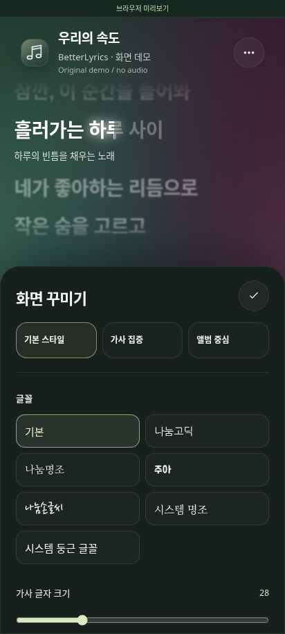

# 홈 화면 위젯과 글꼴

## 홈 화면 위젯

1. 앱의 **설정 → 홈 화면 위젯 → 위젯 추가**를 누릅니다. 홈 화면 앱이 추가 요청을 지원하면 표시되는 확인창에서 추가합니다.
2. 추가 요청을 지원하지 않는 홈 화면에서는 빈 공간을 길게 누르고 **위젯 → BetterLyrics Mobile → 가사 위젯**을 선택합니다.
3. 앱의 **음악 감지** 권한을 허용하고 음악 앱에서 재생합니다. 위젯은 현재 곡과 가사를 표시합니다.

위젯을 누르면 앱이 열립니다. 음악 앱이 지원하는 경우 위젯에서 재생·일시정지와 이전·다음 곡을 사용할 수 있습니다. 크기를 줄이면 앨범 커버와 이전 곡 버튼이 숨겨질 수 있습니다.

**설정 → 홈 화면 위젯**에서 배경(어둡게·밝게·반투명), 가사 글자 크기, 앨범 커버 표시를 바꿀 수 있습니다. 설정은 이 앱의 위젯에 함께 적용됩니다. 위젯을 여러 개 추가하고 각각 크기를 조절할 수 있습니다.

음악 감지 권한이 없거나 음악·가사를 찾지 못했을 때는 위젯에 상태가 표시됩니다. 음악 앱이 재생 위치 또는 제어 기능을 제공하지 않으면 해당 기능을 사용할 수 없습니다. 기기의 절전 설정이나 홈 화면 앱에 따라 갱신 시점이 달라질 수 있습니다.

## 글꼴

브라우저 미리보기 화면입니다.

**설정 → 화면 꾸미기 → 글꼴**에서 기본, 나눔고딕, 나눔명조, 주아, 나눔손글씨와 기기의 명조·둥근 글꼴을 고를 수 있습니다. 선택한 글꼴은 미리보기에 바로 적용되고 저장됩니다. 화면 프리셋을 바꿔도 선택한 글꼴은 유지되며, **화면 스타일 초기화**를 누르면 기본 글꼴로 돌아갑니다. 한글 글꼴 4종은 앱에 포함되어 네트워크 없이 사용할 수 있습니다.

## 참고 자료

- [Retro Music Player의 위젯 구현](https://github.com/RetroMusicPlayer/RetroMusicPlayer/blob/e85b2aca8f00a66e9cc4c7327a8b167dcd35e25e/app/src/main/java/code/name/monkey/retromusic/appwidgets/AppWidgetSmall.kt): 홈 화면 위젯, 재생 제어, 테마와 크기별 배치를 참고했습니다. 구현은 이 앱의 MediaSession·가사 구조에 맞춰 작성했습니다.
- [Android 앱 위젯 가이드](https://developer.android.com/develop/ui/views/appwidgets)와 [고급 위젯 업데이트](https://developer.android.com/develop/ui/views/appwidgets/advanced): 크기 조절, 고정 요청, RemoteViews 및 갱신 제한을 참고했습니다.
- [Google Fonts](https://github.com/google/fonts/tree/a4c0b21f839d7ac65a7d8b49eb81bddd110774a3/ofl): 나눔고딕, 나눔명조, 주아, 나눔손글씨 원본과 각 SIL Open Font License를 사용했습니다. 세부 고지와 라이선스는 [THIRD_PARTY_NOTICES.md](../THIRD_PARTY_NOTICES.md)에 있습니다.
